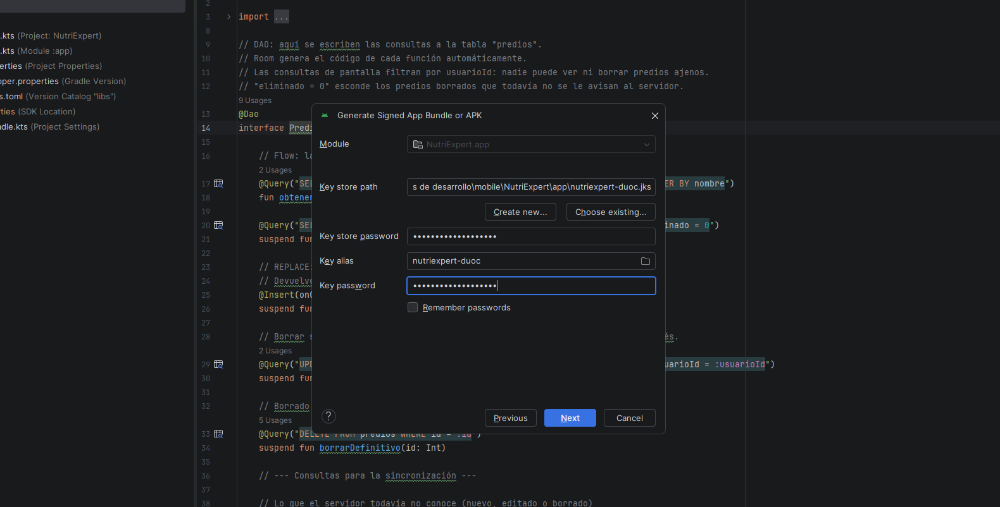
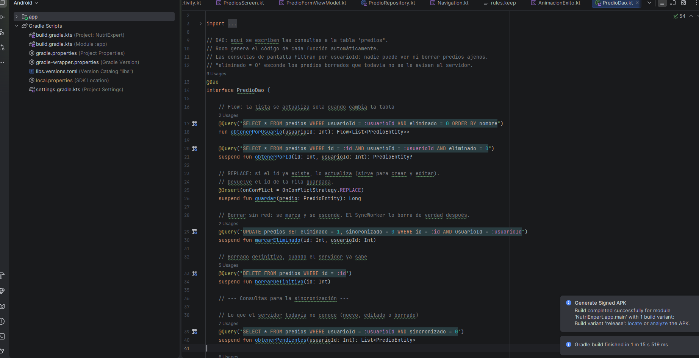

# NutriExpert 🌱

App Android para planificar la **nutrición vegetal y el fertirriego** de predios agrícolas. Corresponde al módulo 3 del prototipo [NutriExpert](https://nutriexpert.netlify.app/) y se desarrolla para un cliente real como proyecto de la asignatura de Desarrollo de Aplicaciones Móviles (Duoc UC).

La app es **offline-first**: todo funciona sin internet y los datos se guardan en el teléfono.

## Equipo

| Integrante         | Tercera entrega |
|--------------------|---|
| Matías Figueroa    | Microservicio `predios` (predios y sectores), CRUD de predios y sectores en la app, sincronización sin red (WorkManager), APK firmado |
| Estefanía Ruiz     | Microservicio `planes`, pantalla Mis planes, clima con Open-Meteo, colección de Postman |
| Fabián Rubio Parra | Microservicio `usuarios`, login, registro y perfil contra el backend, despliegue en AWS EC2 |

## Funcionalidades (etapa 1)

- **Cuenta de usuario:** creación de cuenta e inicio de sesión reales (guardados en el teléfono), cierre de sesión y recuperación de contraseña (requiere servidor).
- **Sectores y análisis:** cada predio se divide en sectores con su cultivo, y cada sector guarda sus análisis de suelo y agua.
- **Plan nutricional:** asistente de 4 pasos para calcular los fertilizantes de un sector.
- **Predios:** crear, listar y editar predios agrícolas.
  - **Ubicación GPS:** botón "Usar mi ubicación" que guarda la latitud y longitud del predio.
  - **Foto del predio:** tomar una foto con la cámara o elegirla de la galería, con vista previa.
- **Formularios validados:** cada campo muestra su propio mensaje de error e ícono; la validación está separada de la pantalla.
- **Animaciones** en la navegación y en los elementos de la interfaz.
- **Persistencia local** con Room (funciona sin conexión).
- **Sincronización con el backend:** predios y sectores se crean, editan y borran en el teléfono y se envían al microservicio `predios` cuando hay internet. Mientras no llegan, la tarjeta muestra "Pendiente de sincronizar".
- En desarrollo dentro de la etapa 1: análisis, plan de nutrición, calendario de riego y reporte.

> Quedan para la etapa 2: asesor, integración con WhatsApp, panel de administración y diagnóstico por foto.

## Recursos nativos y permisos

| Recurso | Permiso | Uso en la app |
|---|---|---|
| Ubicación (GPS) | `ACCESS_FINE_LOCATION`, `ACCESS_COARSE_LOCATION` | Registrar la latitud y longitud del predio |
| Cámara | `CAMERA` | Tomar la foto del predio |
| Galería | No requiere permiso (Photo Picker de Android) | Elegir una foto existente |

Los permisos se piden en tiempo de ejecución, solo cuando el usuario toca el botón correspondiente. Si los rechaza, la app explica por qué los necesita y ofrece abrir los Ajustes.

## Seguridad y autenticación

La app funciona sin internet, así que las cuentas se guardan en el teléfono (Room):

- **Contraseñas con hash:** nunca se guarda la contraseña. Se guarda un hash PBKDF2 con sal aleatoria por usuario y 100.000 iteraciones (`seguridad/Contrasenas.kt`). La verificación compara en tiempo constante.
- **Contraseñas exigentes:** mínimo 8 caracteres, con letras y números.
- **Sesión:** se guarda solo el id del usuario en preferencias privadas (`seguridad/SesionManager.kt`). Si hay sesión, la app abre directo en "Mis predios"; al cerrar sesión se limpia la pila de pantallas.
- **Datos separados por usuario:** cada predio tiene dueño (`usuarioId`) y todas las consultas filtran por él, así un usuario no ve ni borra predios de otro.
- **Bloqueo por intentos:** tras 5 intentos fallidos el login se bloquea 30 segundos. El mensaje de error no revela si el correo existe.
- **Sin copias de seguridad:** la base de datos y la sesión se excluyen de las copias en la nube y del traspaso a otro teléfono.

## Arquitectura

```
App Android (Compose)                         Backend (Spring Boot)
  Pantalla → ViewModel → Repositorio            usuarios  :8080 ─┐
                            ├──→ Room (fuente de verdad)         ├─→ MariaDB (EC2) / H2 (PC)
                            └──→ Retrofit ── HTTP ── predios :8081 ─┘
  SyncWorker (WorkManager) reintenta lo pendiente cuando vuelve la red
```

La app es offline-first: todo se guarda primero en Room con `sincronizado = false`. El `SyncWorker` envía lo pendiente al microservicio, guarda el `remoteId` que responde el servidor y marca `sincronizado = true`. Si no hay red, el dato queda en el teléfono y se reintenta después.

## Microservicios y endpoints

Todos responden: `200` correcto, `201` creado, `204` borrado, `400` faltan datos, `404` no existe.

### `predios` (puerto 8081) — carpeta `backend/predios`

| Método | Ruta | Descripción |
|---|---|---|
| GET | `/api/predios?usuarioId={id}` | Lista los predios de un usuario |
| GET | `/api/predios/{id}` | Obtiene un predio |
| POST | `/api/predios` | Crea un predio |
| PUT | `/api/predios/{id}` | Actualiza un predio |
| DELETE | `/api/predios/{id}` | Borra un predio y sus sectores |
| GET | `/api/sectores?predioId={id}` | Lista los sectores de un predio |
| GET | `/api/sectores/{id}` | Obtiene un sector |
| POST | `/api/sectores` | Crea un sector |
| PUT | `/api/sectores/{id}` | Actualiza un sector |
| DELETE | `/api/sectores/{id}` | Borra un sector |

Ejemplo de predio (JSON):

```json
{ "usuarioId": 1, "nombre": "Los Aromos", "comuna": "Quillota", "latitud": -32.88, "longitud": -71.25, "superficieHa": 10.0 }
```

Ejemplo de sector (JSON):

```json
{ "predioId": 1, "nombre": "Sector norte", "cultivo": "cultivo-tomate", "superficieHa": 4.0 }
```

### `planes` (puerto 8082) — carpeta `backend/planes`

| Método | Ruta | Descripción |
|---|---|---|
| GET | `/api/planes?sectorId={id}` | Lista los planes de un sector |
| GET | `/api/planes/{id}` | Busca un plan |
| POST | `/api/planes` | Crea un plan (`201`) |
| PUT | `/api/planes/{id}` | Actualiza un plan (`404` si no existe) |
| DELETE | `/api/planes/{id}` | Borra un plan (`204`) |

```json
{ "sectorId": 1, "nombreTemporada": "Temporada 2026", "fechaInicio": "2026-09-01", "fechaTermino": "2027-03-31" }
```

### API externa: Open-Meteo (clima)

La app consulta el clima de cada predio con Retrofit en `https://api.open-meteo.com/v1/forecast`, usando la latitud y longitud guardadas con el GPS. No necesita llave ni registro.

| Parámetro | Valor que usa la app |
|---|---|
| `latitude`, `longitude` | Ubicación del predio |
| `current` | `temperature_2m,weather_code` (temperatura y estado actual) |
| `daily` | `temperature_2m_max,temperature_2m_min` (máxima y mínima, y pronóstico de varios días) |
| `timezone` | `auto` |

El código está en `data/remote/clima/` (`OpenMeteoApi`, `OpenMeteoClient`) y `data/repository/ClimaRepository.kt`.

### `usuarios` (puerto 8080) — carpeta `backend/usuarios`

| Método | Ruta | Descripción |
|---|---|---|
| POST | `/api/usuarios/registro` | Crea una cuenta (`201`). `400` si faltan datos o el correo ya existe |
| POST | `/api/usuarios/login` | Inicia sesión (`200`). `401` si el correo o la contraseña son incorrectos |
| GET | `/api/usuarios/{id}` | Obtiene un usuario |
| PUT | `/api/usuarios/{id}` | Cambia el nombre del usuario |
| DELETE | `/api/usuarios/{id}` | Borra la cuenta |

Ejemplo de registro (JSON):

```json
{ "nombre": "Fabián", "email": "fabian@nutriexpert.cl", "password": "agricola26" }
```

Respuesta (la contraseña **nunca** se devuelve):

```json
{ "id": 1, "nombre": "Fabián", "email": "fabian@nutriexpert.cl" }
```

La contraseña se guarda encriptada con **BCrypt** (`spring-security-crypto`, sin activar Spring Security completo). Debe tener 8 caracteres o más, con letras y números, igual que en la app. El correo se guarda en minúsculas.

## Cómo ejecutar el backend

Requisitos: Java 17. Maven no es necesario, el proyecto trae `mvnw`.

**En el PC (base de datos H2 en memoria):**

```bash
cd backend/predios
./mvnw spring-boot:run        # en Windows: mvnw.cmd spring-boot:run
```

Queda en `http://localhost:8081`. El microservicio de usuarios se corre igual desde `backend/usuarios` y queda en `http://localhost:8080`. La consola de H2 está en `http://localhost:8081/h2-console` (JDBC URL `jdbc:h2:mem:predios`, usuario `sa`, sin clave).

**Tests del backend:** `./mvnw test`

**En la EC2 (MariaDB):**

```bash
cd backend/predios
mvn clean package -DskipTests
DB_HOST=localhost DB_NAME=nutriexpert DB_USER=nutriexpert DB_PASSWORD=<clave> \
  nohup java -jar target/predios-1.0.jar --spring.profiles.active=prod > predios.log 2>&1 &
```

En el Security Group de la EC2 hay que abrir los puertos 8080 y 8081.

### Despliegue en AWS (EC2)

Los tres microservicios corren en una instancia EC2 de AWS Academy, con MariaDB en la misma máquina.

| Dato | Valor |
|---|---|
| Elastic IP | `3.226.195.117` (fija: es la que usa `ApiConfig.kt`) |
| Instancia | `nutriexpert-backend` · t2.micro · Amazon Linux 2023 · región us-east-1 |
| Security Group | `nutriexpert-sg`: 22 (SSH, solo la IP del administrador), 8080, 8081 y 8082 abiertos |
| Base de datos | MariaDB 10.5, solo accesible desde la misma EC2 (el puerto 3306 no está abierto) |

| Servicio | Puerto | Datos |
|---|---|---|
| `usuarios` | 8080 | MariaDB `nutriexpert_usuarios` |
| `predios` | 8081 | MariaDB `nutriexpert_predios` |
| `planes` | 8082 | MariaDB `nutriexpert_planes` |

#### Cómo se levantó (una sola vez)

1. **Instancia:** EC2 t2.micro con Amazon Linux 2023 y llave `vockey`, Security Group `nutriexpert-sg` y una **Elastic IP** asociada (sin ella la IP cambia cada vez que se apaga el laboratorio).
2. **Swap de 2 GB**, porque la t2.micro tiene solo 1 GB de RAM:
   ```bash
   sudo dd if=/dev/zero of=/swapfile bs=1M count=2048
   sudo chmod 600 /swapfile && sudo mkswap /swapfile && sudo swapon /swapfile
   echo '/swapfile swap swap defaults 0 0' | sudo tee -a /etc/fstab
   ```
3. **Java 17, Git y MariaDB:**
   ```bash
   sudo dnf install -y java-17-amazon-corretto-headless git mariadb105-server
   sudo systemctl enable --now mariadb
   ```
4. **Bases y usuario** (en `sudo mysql`). La clave real **no** está en el repositorio:
   ```sql
   CREATE DATABASE nutriexpert_usuarios;
   CREATE DATABASE nutriexpert_predios;
   CREATE DATABASE nutriexpert_planes;
   CREATE USER 'nutriexpert'@'localhost' IDENTIFIED BY '<clave>';
   GRANT ALL PRIVILEGES ON nutriexpert_usuarios.* TO 'nutriexpert'@'localhost';
   GRANT ALL PRIVILEGES ON nutriexpert_predios.* TO 'nutriexpert'@'localhost';
   GRANT ALL PRIVILEGES ON nutriexpert_planes.* TO 'nutriexpert'@'localhost';
   FLUSH PRIVILEGES;
   ```
5. **Código y clave:** se clona el repo en `~/NutriExpert` (rama `develop`) y la clave se guarda **fuera del repo**, en `~/nutriexpert.env` con permisos `600`:
   ```
   DB_HOST=localhost
   DB_USER=nutriexpert
   DB_PASSWORD=<clave>
   ```
6. **Script:** `cp ~/NutriExpert/backend/levantar.sh ~/ && chmod +x ~/levantar.sh`

#### Cómo se actualiza el backend

Después de unir cambios a `develop`, por SSH:

```bash
ssh -i labsuser.pem ec2-user@3.226.195.117
~/levantar.sh
```

[`backend/levantar.sh`](backend/levantar.sh) detiene los servicios, hace `git pull`, compila con Maven y los vuelve a levantar de a uno (con poca memoria cada uno, para que quepan en la t2.micro). Los logs quedan en `~/logs/<servicio>.log`.

**Al iniciar el laboratorio** los microservicios están apagados: hay que entrar por SSH y ejecutar `~/levantar.sh`. MariaDB arranca sola y los datos se conservan.

**Dirección del backend en la app:** `app/src/main/java/cl/duoc/nutriexpert/data/remote/ApiConfig.kt`. Con `http://10.0.2.2` el emulador llega al PC; para la EC2 se cambia por la Elastic IP.

## Tecnologías

- **Kotlin** + **Jetpack Compose** (Material 3)
- Arquitectura **MVVM**: Screen → ViewModel → Repositorio → Room
- **Room** como base de datos local
- **Retrofit** + Gson para consumir los microservicios
- **WorkManager** para sincronizar en segundo plano
- **Spring Boot 3** (Java 17) + JPA para los microservicios, H2 en el PC y MariaDB en la EC2
- Tests: **JUnit** + **MockK** (app) y **JUnit 5** + **MockMvc** (backend)
- Android Gradle Plugin **9.3.1**
- Paquete `cl.duoc.nutriexpert` · minSdk 24

## Cómo ejecutar

1. Clonar el repositorio:
   ```bash
   git clone https://github.com/matiasfigueroaesc/NutriExpert.git
   ```
2. Abrir la carpeta en **Android Studio** (File → Open).
3. Esperar a que termine la sincronización de Gradle.
   ⚠️ Si Android Studio ofrece el *AGP Upgrade Assistant*, **no lo aceptes**: el proyecto usa AGP 9.3.1.
4. Conectar un teléfono Android (con depuración USB activada) o iniciar un emulador con Android 7.0 (API 24) o superior.
5. Presionar **Run ▶** (`app`).

**Para probar GPS y cámara:**
- En un teléfono real, simplemente acepta los permisos cuando la app los pida.
- En el emulador, la ubicación se simula desde *Extended controls (⋯) → Location*, y la cámara usa una escena virtual.

## Tests

- **App:** `./gradlew testDebugUnitTest` (o clic derecho en `app/src/test` → *Run Tests*). Los repositorios y ViewModels se prueban con MockK, que finge Room y el servidor, incluido el caso sin red.
- **Backend:** `cd backend/predios && ./mvnw test`.

## APK firmado

- APK listo para instalar: `apk/NutriExpert.apk` (modo release, firmado).
- Llave de firma: `app/nutriexpert-duoc.jks`, alias `nutriexpert-duoc`, clave `NutriExpertDuoc2026`. Certificado a nombre de NutriExpert, equipo Matías Figueroa, Estefanía Ruiz y Fabián, Duoc UC, Chile. La configuración está en `signingConfigs` de `app/build.gradle.kts`.
- Para generar el APK de nuevo: **Build → Generate Signed App Bundle or APK → APK**, elegir `app/nutriexpert-duoc.jks`, o desde la terminal `./gradlew assembleRelease`. El APK queda en `app/build/outputs/apk/release/app-release.apk`.

**Firma con la llave del equipo** (Build → Generate Signed App Bundle or APK → APK):



**APK release generado y firmado:**



## Estructura del proyecto

```
app/src/main/java/cl/duoc/nutriexpert/
├── data/
│   ├── local/       # Entidades, DAOs y base de datos Room
│   ├── remote/      # Retrofit: ApiConfig, ApiService y DTO
│   └── repository/  # Repositorios (Room + servidor)
├── domain/        # Modelos y motor de cálculo del plan nutricional
├── nativo/        # Ayudantes de GPS (UbicacionHelper) y cámara/galería (FotoHelper)
├── seguridad/     # Hash de contraseñas y sesión del usuario
├── sync/          # SyncWorker y programación con WorkManager
├── ui/
│   ├── components/  # Componentes reutilizables (barra superior, botones, campos, ubicación, foto)
│   ├── plan/        # Asistente del plan nutricional
│   └── views/       # Pantallas de la app
├── utils/         # Validaciones de formularios
└── viewmodel/     # ViewModels
```

```
backend/predios/src/main/java/cl/duoc/predios/
├── model/         # Entidades JPA (Predio, Sector)
├── repository/    # Acceso a la base de datos (JpaRepository)
├── service/       # Reglas: validar, crear, actualizar, borrar
└── controller/    # Endpoints REST
```

## Forma de trabajo

- `main`: versión estable · `develop`: integración · `feature/...`: una rama por tarea.
- Cada rama se une a `develop` mediante Pull Request.
- Commits en español con prefijo `feat:` o `fix:`.
- Tareas organizadas en Trello, una tarjeta por tarea con su responsable.
- Tablero de tareas: [Trello NutriExpert](https://trello.com/b/PKewiNe3)
